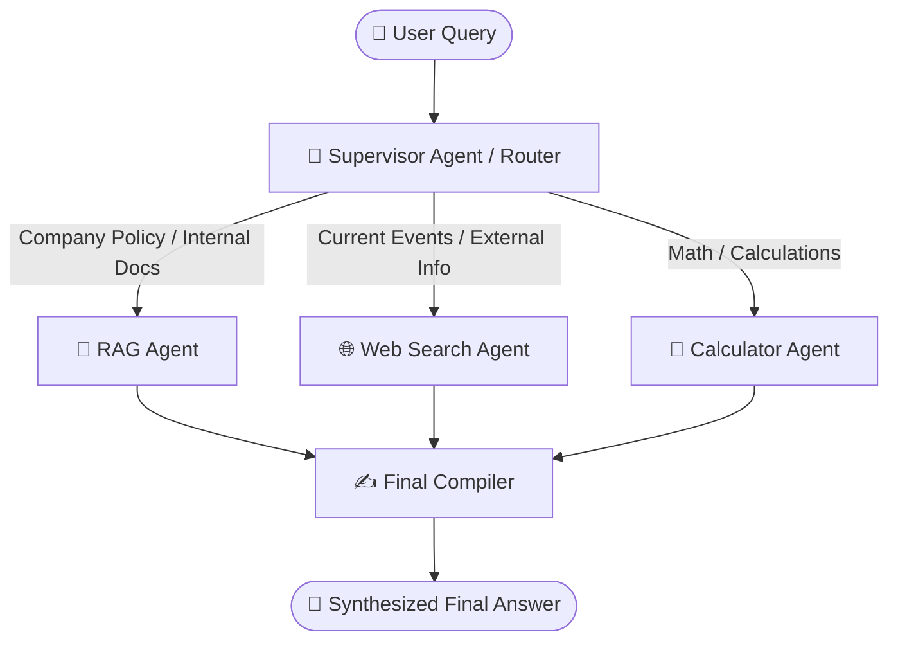

# ⚡ Multi-Agent Research Assistant

An intelligent, cooperative multi-agent research assistant built using **LangGraph**, **Google Gemini**, **RAG (Retrieval-Augmented Generation)**, **Tavily Web Search**, and a safe **Calculator Tool**, complete with a modern **Streamlit Frontend**.

---

## 🏛️ System Architecture



- **🧠 Supervisor Agent**: Automatically analyzes user intent and delegates to one or more specialized agents (single-agent or multi-agent joint task).
- **📄 RAG Agent**: Searches internal company policies (`company_policy.pdf`) and any uploaded PDF documents with stemming and semantic fallback.
- **🌐 Web Agent**: Performs live, real-time web searches using the Tavily API.
- **🧮 Calculator Agent**: Robust natural-language math evaluator (e.g. percentages, leave calculations, formulas).
- **✍️ Final Compiler**: Synthesizes intermediate outputs from all active agents into a unified, clean answer.

---

## 🚀 Getting Started

### 1. Prerequisites & Virtual Environment

Ensure you have Python 3.10+ installed.

```bash
python -m pip install -r requirements.txt
```

### 2. Environment Configuration

Ensure your `.env` file contains your Google Gemini and Tavily API keys:

```env
GOOGLE_API_KEY=your_google_api_key_here
TAVILY_API_KEY=your_tavily_api_key_here
```

---

## 🖥️ Running the Application

### Option A: Streamlit Web UI (Recommended)

Run the modern Streamlit web frontend:

```bash
python -m streamlit run streamlit_app.py
```
*(or on Windows, simply double-click `run_app.bat`)*

**Frontend Features:**
- 💬 **Interactive Chat Interface**: Chat with the multi-agent system.
- 🏷️ **Agent Routing Badges**: Visual indicator of which agent(s) were selected for each prompt.
- 🔍 **Agent Reasoning & Intermediate Outputs**: Collapsible view showing raw RAG excerpts, Tavily search snippets, and math calculations.
- 📁 **Knowledge Base & PDF Uploader**: View existing company policy documents or upload new PDF documents on-the-fly.
- 💡 **One-Click Example Prompts**: Quickly test different single-agent and multi-agent workflows.

### Option B: Terminal / CLI Mode

You can also run the terminal-based interactive loop:

```bash
python -m app.main
```

---

## 💡 Example Queries

| Category | Example Query | Selected Agents |
|---|---|---|
| **Company Policy** | *"How many annual, sick, and casual leaves are employees eligible for?"* | `RAG Agent` |
| **Work From Home** | *"Can employees work from home and what is the approval process?"* | `RAG Agent` |
| **Web Research** | *"What are the latest updates on Gemini AI models?"* | `Web Agent` |
| **Math / Calculator** | *"What is 18 leaves plus 12 leaves plus 6 leaves?"* | `Calculator Agent` |
| **Multi-Agent (RAG + Math)** | *"If an employee has 18 annual leaves and uses 25% of them, how many leaves are left?"* | `RAG + Calculator` |
